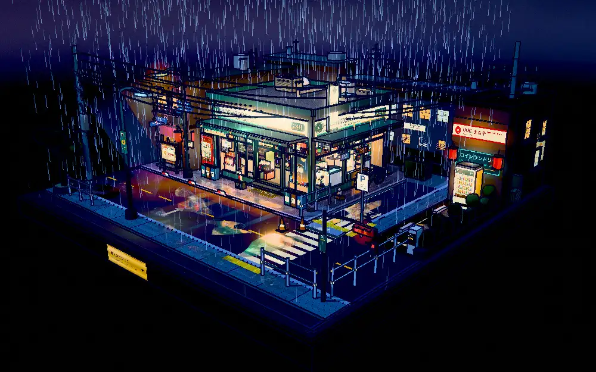
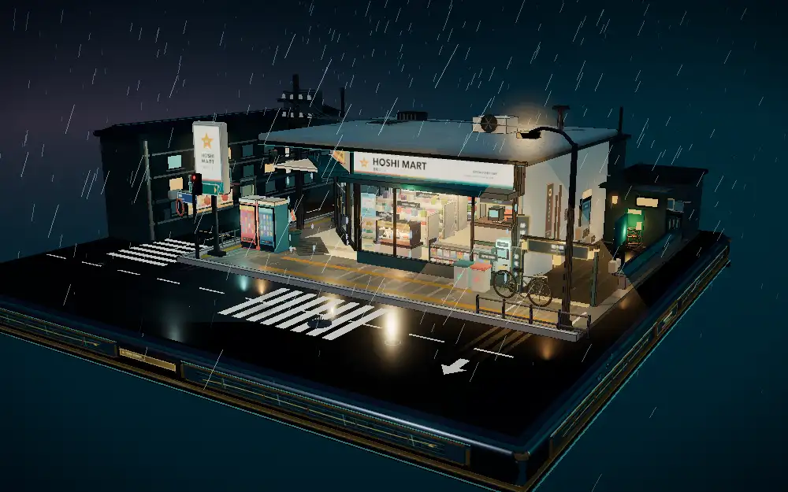
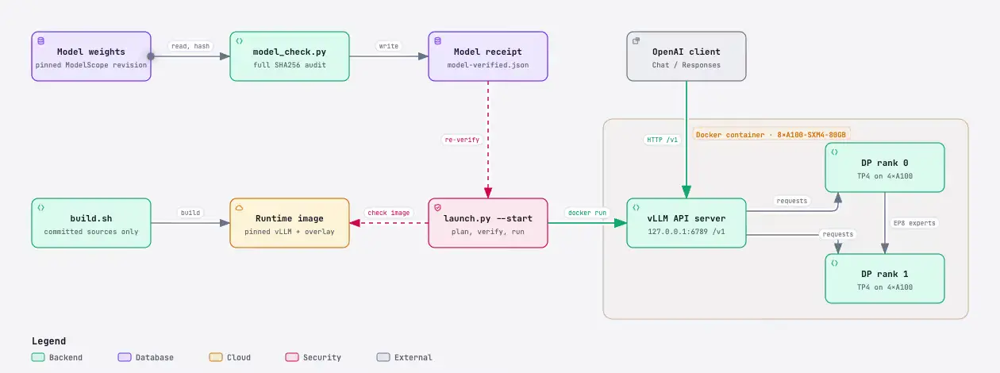

<p align="center">
  <picture>
    <source media="(prefers-color-scheme: dark)" srcset="docs/assets/logo_dark.svg">
    
  </picture>
</p>

<p align="center"><b>主线向前，A100 不掉队。</b><br>基于 <a href="https://github.com/vllm-project/vllm">vLLM</a>，在 8×A100 上提供 1M 上下文的 DeepSeek-V4.1-Flash 服务。</p>

<p align="center">
  <a href="https://github.com/RedHeartSecretMan/vllm-dsf-rearguard/actions/workflows/cpu.yml"></a>
  <a href="LICENSE"></a>
  <a href="CHANGELOG.md"></a>
  
  
</p>

<p align="center"><a href="README.md">English</a> · <b>简体中文</b> · <a href="docs/performance.md">性能</a> · <a href="docs/validation.md">验证</a> · <a href="docs/architecture.md">架构</a> · <a href="CHANGELOG.md">更新日志</a></p>

---

vllm-dsf-rearguard 用于在 `8×A100-SXM4-80GB / NVSwitch` 上部署 DeepSeek-V4.1-Flash-1017。项目基于固定版本的 vLLM 镜像提供适配层，并配套权重校验、镜像构建、服务启动、功能验收和性能测试工具。仓库不包含模型权重和预构建镜像。

DSF 指 DeepSeek-V4.1-Flash；Rearguard 意为殿后部队。

## 雨夜便利店

<table>
  <tr>
    <th width="50%">dsh v0.2.1-rc.3</th>
    <th width="50%">Codex 26.1021.31345</th>
  </tr>
  <tr>
    <td width="50%"><a href="https://redheartsecretman.github.io/vllm-dsf-rearguard/showcase/rainy-konbini-dsh.html"></a></td>
    <td width="50%"><a href="https://redheartsecretman.github.io/vllm-dsf-rearguard/showcase/rainy-konbini-codex.html"></a></td>
  </tr>
  <tr>
    <td width="50%">一轮生成</td>
    <td width="50%">迭代 5 轮：前两轮由 GPT-6.1 Terra（ultra）评审后返工，后两轮由人工评审后返工</td>
  </tr>
</table>

以上两个场景使用同一段提示词 [rainy-konbini-prompt.md](docs/showcase/rainy-konbini-prompt.md)，由本项目部署的 DeepSeek-V4.1-Flash-1017 以 `reasoning_effort=max` 耗时约 2–3 小时生成。两者都是不依赖外部资源的单个 HTML 文件，基于 [Three.js](https://threejs.org) 实现。

## 为什么需要这个项目

- **适配 SM80。** 上游 vLLM 主线未覆盖 DeepSeek-V4.1-Flash 在 A100（SM80）上的运行路径；本项目为 A100 补齐稀疏 MLA、FP8 KV cache、DSpark 投机解码和 EP8 通信所需的适配。
- **1M 上下文可用。** 8 张 80GB A100 上可以启动并处理 1,047,000 token 的实际输入，支持图片、视频和工具调用。
- **顺带支持视频。** DeepSeek-V4.1-Flash 的权重只有图片分隔符，没有训练过的视频分隔符。适配层把每个视频采样为最多 32 帧，并用稳定的文本 prompt 包装这些帧，模型就能把视频当作带时间戳的有序图片帧来理解；多轮对话也能继续引用同一个视频。
- **版本全部固定。** 基础镜像按 digest 固定，模型按 revision 和逐文件 SHA256 校验，适配层按文件指纹安装；任一项不一致都会拒绝启动。
- **每组配置完整测试。** 推荐配置都经过性能、功能、协议和精度测试，数据和测试工具一并公开。

## 关键结果

| 项目 | 结果 |
|---|---|
| 配置矩阵 | 262K / 524K / 1M 上下文 × 0.90 / 0.925 / 0.95 显存水位，9 组配置的 723 个适用测试项全部通过 |
| 短请求并发 | 262K / 0.90、C256 时输出 7,039 token/s，总吞吐 8,469 token/s |
| 1M 长请求 | 1,047,000 token 输入、C16 时 16/16 成功，三档水位的输入吞吐为 7,865–8,018 token/s |
| 全模型 PPL | 9 组配置各 134 个窗口，token PPL 为 2.770433–2.774319 |
| GPQA Diamond | 198 题，4 轮平均准确率 91.54% |
| 持续负载 | 1M 配置 30 分钟闭环测试，7,940/7,940 个请求成功 |

完整数据见[性能与调优](docs/performance.md)，测试条件和覆盖范围见[验证结果](docs/validation.md)。

## 架构

<a href="https://redheartsecretman.github.io/vllm-dsf-rearguard/architecture.html">
<picture>
  <source media="(prefers-color-scheme: dark)" srcset="docs/assets/architecture-motion-dark.webp">
  
</picture>
</a>

`launch.py` 先生成启动计划；启动服务时，它会校验权重、镜像源码和 GPU 状态，再创建容器。容器内是固定版本的 vLLM 与适配层，默认以两个 DP 实例（各 TP4）和跨 8 卡的 EP8 专家并行运行。实现细节见[架构说明](docs/architecture.md)。

架构图由 [Archify](https://github.com/tt-a1i/archify) 根据 [architecture.archify.json](docs/assets/architecture.archify.json) 生成。

## 适用范围

| 项目 | 支持范围 |
|---|---|
| 模型 | DeepSeek-V4.1-Flash-1017，固定 [ModelScope](https://modelscope.cn) revision |
| 硬件 | `8×A100-SXM4-80GB / NVSwitch` |
| 并行方式 | 默认 `TP4 / DP2 / EP8`，也支持 `TP8 / EP8` |
| 上下文 | 262144、524288、1048576 token（文中记为 262K、524K、1M） |
| 输入 | 文本、图片、工具调用；视频由服务端采样为图片帧 |
| 接口 | OpenAI 兼容的 Chat Completions 和 Responses |

## 快速开始

### 1. 准备环境

需要 Linux、Python 3.10 及以上、[Docker](https://www.docker.com/)、[NVIDIA Container Toolkit](https://docs.nvidia.com/datacenter/cloud-native/container-toolkit/latest/)、可用的 CUDA 驱动和 8 张空闲的 A100-SXM4-80GB。模型需要提前从 ModelScope 下载 `deepseek-ai/DeepSeek-V4.1-Flash-1017` 到本机，完整目录约 510 GB；revision 和文件清单见 `manifests/model-files.json`。

```bash
export MODEL=/path/to/DeepSeek-V4.1-Flash-1017
```

### 2. 校验模型

完整校验会读取全部权重并计算 SHA256，结果写入 `runtime/model-verified.json`。启动服务时会读取这份校验结果。

```bash
python3 scripts/model_check.py "$MODEL" --full --output runtime/model-verified.json
```

### 3. 构建镜像

构建脚本只使用已提交的源码，生成 `vllm-dsf-rearguard:dev` 镜像，并在不分配 GPU 的容器中检查适配层安装结果。工作区有未提交的改动时，脚本会拒绝构建。

```bash
bash scripts/build.sh
```

### 4. 生成启动计划

先生成启动计划，确认模型路径、端口和启动参数。这一步只输出计划，不会创建容器或占用 GPU。

```bash
python3 launch.py "$MODEL" \
  --parallel tp4dp2 --dspark 5 --max-seqs 256 \
  --context 1048576 --chunk 16384 --memory 0.90 \
  --experimental stacked-kv --experimental bounded-prefill \
  --no-disable-chunked-mm-input --responses-store \
  --port 6789
```

### 5. 启动服务

确认启动计划后，使用 `--start` 启动服务。启动前会检查镜像源码、模型校验结果和 8 张 GPU 的空闲状态，任一项不满足都会停止启动。

```bash
python3 launch.py "$MODEL" \
  --parallel tp4dp2 --dspark 5 --max-seqs 256 \
  --context 1048576 --chunk 16384 --memory 0.90 \
  --experimental stacked-kv --experimental bounded-prefill \
  --no-disable-chunked-mm-input --responses-store \
  --port 6789 --start
```

服务只监听本机的 `127.0.0.1:6789`，接口前缀为 `/v1`，模型名为 `deepseek-ai/DeepSeek-V4.1-Flash-1017`。启动会重新校验全部权重，模型加载和图捕获也需要一段时间；容器默认名为 `vllm-dsf-rearguard`，可用 `docker logs -f vllm-dsf-rearguard` 查看进度，`/health` 返回成功后再发送请求。

### 6. 发送请求

```bash
curl http://127.0.0.1:6789/health
curl http://127.0.0.1:6789/v1/models

curl http://127.0.0.1:6789/v1/chat/completions \
  -H 'Content-Type: application/json' \
  -d '{
    "model": "deepseek-ai/DeepSeek-V4.1-Flash-1017",
    "messages": [{"role": "user", "content": "用一句话介绍你自己。"}],
    "max_tokens": 128
  }'
```

## 配置建议

快速开始中的配置适合作为首次部署起点：1M 上下文、16K chunk、0.90 显存水位，并开启多模态分块、`stacked-kv` 和 `bounded-prefill`。

| 参数 | 建议 |
|---|---|
| `--context` | 选择能容纳最长输入与最大输出之和的上下文 |
| `--memory` | 从 `0.90` 开始；需要更大 KV 容量时，再在目标负载上验证 `0.925` 或 `0.95` |
| `--chunk` | 建议显式设为 `16384`；`32768` 需要更多显存预留，1M 上下文时需要 `0.95` 水位 |
| `--no-disable-chunked-mm-input` | 处理大图、多图或视频时开启 |
| `--responses-store` | 需要 `previous_response_id` 时开启；内存历史由 `VLLM_RESPONSES_API_STORE_MAX_SIZE`（默认 `10000`）限制为 LRU，并只保存在当前服务进程中 |
| `--experimental` | 可重复传入；快速开始中的 `stacked-kv` 和 `bounded-prefill` 已完成完整测试，其他选项需在目标负载上验证 |

启动日志会给出实际 KV 容量。不同负载的吞吐、延迟和容量取舍见[性能与调优](docs/performance.md)。

## 文档

| 文档 | 内容 |
|---|---|
| [架构说明](docs/architecture.md) | 适配层结构、协议与多模态处理、性能实现、构建与启动安全 |
| [性能与调优](docs/performance.md) | 配置建议、测试方法、完整性能数据和配置对照 |
| [验证结果](docs/validation.md) | 功能、协议、精度、资源边界、持续负载和构建校验 |
| [更新日志](CHANGELOG.md) | 版本功能、优化、修复和使用限制 |
| [适配层说明](adaptation/README.md) | vLLM 适配文件、清单和安装流程 |

## 本地检查

以下检查无需 GPU，与 CI 保持一致。CPU 版 PyTorch 用于热路径检查和部分单元测试；依赖镜像或模型 tokenizer 的少量单元测试会自动跳过。

```bash
python3 -m pip install ruff numpy torch --extra-index-url https://download.pytorch.org/whl/cpu
ruff check .
python3 -m unittest discover -s tests -v
CUDA_VISIBLE_DEVICES= python3 -m scripts.hotpaths.check
```

GPU 验收需要目标硬件和已启动的服务，测试工具见[性能与调优](docs/performance.md#测试方法)。

## 致谢

本项目建立在 [vLLM](https://github.com/vllm-project/vllm) 之上，改编了 [wtdcode/vllm-backport](https://github.com/wtdcode/vllm-backport) 及其关联项目，并参考了 vLLM 与 [SGLang](https://github.com/sgl-project/sglang) PR。

vllm-dsf-rearguard 是独立项目，不隶属于 vLLM 项目或 PyTorch Foundation，也未获得其认可。

## 许可证

项目源码遵循 [Apache-2.0](LICENSE)。第三方来源和许可证说明见 [NOTICE](NOTICE)。
